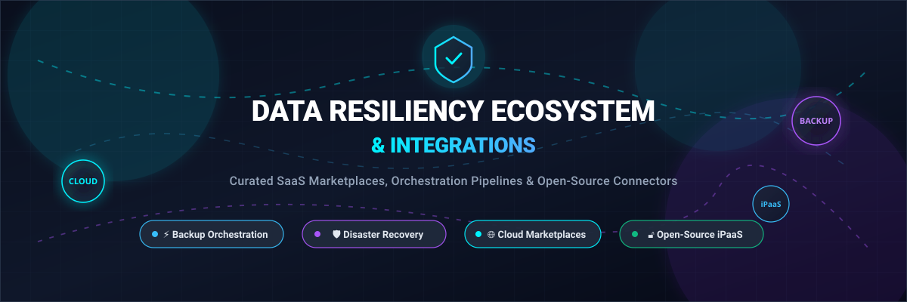

# Awesome Data Resiliency Ecosystem & Integrations 🛡️

  

  
  
  
  
  
  

---

## 📖 Overview

A curated list of **SaaS Marketplaces**, **Cloud Data Protection Hubs**, **Backup Orchestration Pipelines**, and **Open-Source Integration Platforms**. 

In modern cloud and enterprise operations, data resiliency goes far beyond point-in-time backups. True cyber resilience requires automated connectivity between disaster recovery runtimes, backup appliances, security orchestration tools (SIEM/SOAR), IT service management (ITSM), and cloud infrastructure. When ransomware strikes or infrastructure fails, automated integration connectors ensure instant failover, real-time ticket escalation, and verifiable compliance evidence for audit trails.

---

## 📑 Table of Contents
- [📊 Sector Overview & Market Dynamics](#-sector-overview--market-dynamics)
- [☁️ SaaS & Hosted Ecosystem Marketplaces](#️-saas--hosted-ecosystem-marketplaces)
- [🔓 Open-Source GitHub Projects & Connector Frameworks](#-open-source-github-projects--connector-frameworks)
- [🏗️ Architecture: Composable Open-Source Resiliency Stack](#️-architecture-composable-open-source-resiliency-stack)
- [🤝 How to Contribute](#-how-to-contribute)
- [💖 Support](#-support)
- [⭐ Star History](#-star-history)
- [⚠️ Disclaimer](#️-disclaimer)

---

## 📊 Sector Overview & Market Dynamics

The global **Data Resiliency, Backup, and Disaster Recovery (DRaaS)** market is estimated at **$26.6B–$44.7B in 2026** (with DRaaS expanding at a 22%+ CAGR), fueled by escalating cyber threats, ransomware extortion, and operational mandates such as the EU's DORA, HIPAA, and NIS2.

The market structure is **moderately fragmented**: while massive hyperscalers (Microsoft, AWS, Google Cloud) and enterprise titans anchor cloud storage infrastructure, no single vendor captures a winner-take-all monopoly over data resiliency ecosystems. Over 88% of enterprise IT departments operate multi-vendor environments requiring custom integration runtimes, security bridges, and third-party connector pipelines to link distinct on-premise, SaaS, and hybrid cloud backup assets.

---

## ☁️ SaaS & Hosted Ecosystem Marketplaces

Below is a detailed breakdown of the leading enterprise SaaS marketplaces and integration hubs powering backup orchestration, disaster recovery connectors, and cyber-resilience workflows. Ranked in descending order of vendor scale (Market Capitalization / Valuation).

| Product / Marketplace 🏷️ | Description 📝 | Company Scale / Valuation 📈 | Starting Pricing 💵 | Free Tier / Trial Limits ⏱️ |
|:---|:---|:---|:---|:---|
| **[Microsoft Azure Marketplace](https://azuremarketplace.microsoft.com/)** | Commercial marketplace hosting thousands of certified enterprise data resiliency, backup, and cyber disaster recovery solutions running natively on Microsoft Azure. | **~$3.1 Trillion** (Market Cap) | Variable by product; publishers pay **3% standard transaction fee** per sale; Azure consumption billed directly. | **30-day trial with $200 free credit** across Azure services + 55+ services free for 12 months. |
| **[AWS Marketplace](https://aws.amazon.com/marketplace)** | Extensive digital catalog for data protection software, SaaS connectors, and disaster recovery orchestration across AWS clouds. | **~$2.1 Trillion** (Parent Amazon Market Cap) | Variable by product; supports hourly, usage-based, or annual contracts (**up to 40% discount** vs. pay-as-you-go). | **Free trials** available on select products (typically 7 to 30 days, up to 100 hrs compute); AWS Free Tier includes 12 months free on core services. |
| **[Google Cloud Marketplace](https://cloud.google.com/marketplace)** | Enterprise marketplace for automated backup appliances, storage replication tools, and data protection microservices deployed on Google Cloud Platform. | **~$2.0 Trillion** (Parent Alphabet Market Cap) | Variable by listing; flat monthly/annual subscriptions or pay-as-you-go usage linked to GCP project billing. | **90-day trial with $300 free credits** for Google Cloud Platform services + 20+ always-free products. |
| **[Salesforce AppExchange](https://appexchange.salesforce.com/)** | Leading enterprise cloud marketplace providing native data backup, disaster recovery, and data protection connectors (e.g., Own, Odaseva, Veeam). | **~$280 Billion** (Market Cap) | Enterprise Platform starting at **$25/user/month** (Starter) to **$100/user/month** (Platform Plus); partner apps priced separately. | **Free to browse and install free listings**; paid backup apps offer **14-day to 30-day free trials**. |
| **[ServiceNow Store](https://www.servicenow.com/)** | Certified enterprise marketplace for IT operations and resiliency integrations. Integrates backup incident reporting, disaster recovery playbooks, and CMDB sync. | **~$190 Billion** (Market Cap) | Starter custom packages from **~$10,000/year** enterprise contracts; certified store apps set individual partner pricing. | **90-day free trial** for certified apps available strictly on sub-production / developer sandbox instances. |
| **[Datadog Marketplace](https://www.datadoghq.com/)** | Telemetry and observability marketplace tracking backup pipeline integrity, storage failovers, and cyber-resiliency performance metrics. | **~$42 Billion** (Market Cap) | Infrastructure Pro starts at **$15/host/month** (billed annually) or **$18/host/month** (month-to-month); Marketplace units at $0.01. | **Free forever plan** for up to **5 hosts** (1-day metric retention); plus **14-day fully featured free trial** with unlimited hosts. |
| **[Atlassian Marketplace](https://marketplace.atlassian.com/)** | App directory extending Jira and Confluence with incident response hooks, backup compliance dashboards, and DR runbook trackers. | **~$40 Billion** (Market Cap) | Jira Cloud standard begins at **$7.90/user/month**; paid ecosystem apps start around **$250/year** (up to 50 users). | **Free forever tier** for Jira/Confluence up to **10 users** (2 GB storage); Marketplace paid apps offer **30-day free trials**. |
| **[Splunkbase](https://splunkbase.splunk.com/)** | Central app exchange for Splunk and Cisco security ecosystems. Routes backup failure telemetry, ransomware detection alerts, and audit logs. | **~$28 Billion** (Acquisition Value by Cisco) | Splunk Workload pricing starting from **~$150/month/workload unit** (annual commit); apps range from free to paid. | **Splunk Free** on-premises license offers **500 MB/day indexing forever**; Splunk Cloud offers **14-day free trial** (5 GB/day limit). |
| **[Okta Integration Network](https://www.okta.com/integration-network/)** | World's largest identity marketplace connecting identity lifecycle governance and SSO directly to enterprise backup vaults and DR environments. | **~$13 Billion** (Market Cap) | Single Sign-On starts at **$2/user/month**; Adaptive MFA starts at **$3/user/month** (minimum $1,500/year annual contract). | **30-day free trial** with full access to the Okta Workforce Identity Cloud and catalog connectors; free listing for developers. |
| **[Druva Marketplace](https://developer.druva.com/page/partner-integrations)** | Dedicated data security and resilience integration hub bridging Druva Data Security Cloud with SIEM, SOAR, ITSM, and identity tools. | **~$2 Billion** (Private Valuation) | SaaS Protection starting at **$2.50 to $8/user/month**; Server workloads start at **$210/TB/month** consumption credits. | **30-day free trial** covering full cloud backup, ransomware recovery sandbox, and pre-built connectors (extendable to 60 days via sales). |

---

## 🔓 Open-Source GitHub Projects & Connector Frameworks

A curated set of open-source tools, distributed integration engines, and CLI backup runtimes. Organizations leverage these to build transparent, self-hosted, vendor-agnostic data protection workflows without recurring per-connector fees.

Ranked in descending order of community popularity (**GitHub Star Count**):

| Project 🛠️ | Community Stars ⭐ | Primary Role & Description 📋 |
|:---|:---|:---|
| **[n8n](https://github.com/n8n-io/n8n)** |  | **Workflow Automation & Visual iPaaS**: Fair-code low-code integration tool with 400+ nodes. Ideal for stitching together backup API triggers, webhooks, Slack incident alerts, and cloud recovery pipelines. |
| **[Rclone](https://github.com/rclone/rclone)** |  | **Multi-Cloud Sync & Storage Connector**: The Swiss Army knife of cloud storage data synchronization. Supports 70+ cloud providers (S3, B2, Azure Blob, Google Drive) with encryption, multi-threading, and deduplication. |
| **[Restic](https://github.com/restic/restic)** |  | **Secure Encrypted Backup Program**: High-performance, deduplicated backup CLI written in Go. Natively encrypts all snapshots and streams to arbitrary SFTP, REST, or object storage targets. |
| **[Airbyte](https://github.com/airbytehq/airbyte)** |  | **Data Movement & ELT Connectors**: Open-source data integration engine featuring 300+ pre-built connectors. Useful for extracting and consolidating backup audit logs and compliance metrics into central warehouses. |
| **[Kopia](https://github.com/kopia/kopia)** |  | **Encrypted Snapshot & Backup Engine**: Fast and secure open-source backup tool with client-side zero-knowledge encryption, content-defined chunking deduplication, and GUI/CLI interfaces. |
| **[BorgBackup](https://github.com/borgbackup/borg)** |  | **Deduplicating Archiver**: Space-efficient, authenticated, and encrypted backup tool designed for daily automated server backups and offsite sync. |
| **[Velero](https://github.com/vmware-tanzu/velero)** |  | **Kubernetes Disaster Recovery & Migration**: Community-standard tool for backing up, restoring, and performing disaster recovery on Kubernetes cluster resources and persistent volumes. |
| **[Apache Camel](https://github.com/apache/camel)** |  | **Enterprise Integration Patterns (EIP)**: Battle-tested framework featuring 300+ enterprise connectors. Best for orchestrating mission-critical data protection routines across JVM enterprise apps. |
| **[Spring Integration](https://github.com/spring-projects/spring-integration)** |  | **Spring Enterprise Messaging**: Enables lightweight messaging within Spring-based architectures, facilitating seamless routing between backup events, message queues, and storage drivers. |
| **[K8up](https://github.com/k8up-io/k8up)** |  | **Kubernetes Backup Operator**: Cloud-native backup operator built on Restic, enabling declarative snapshot schedules, verification, and automated PVC restore workflows. |
| **[Bacula-Web](https://github.com/bacula-web/bacula-web)** |  | **Open-Source Backup Monitoring & Analytics**: Open-source web dashboard providing telemetry, job status, and visual reporting for Bacula backup infrastructure. |
| **[WSO2 Micro Integrator](https://github.com/wso2/product-integrator)** |  | **Cloud-Native Low-Code Integration**: High-performance integration runtime with visual designer support, perfect for routing high-volume backup alerts and coordinating multi-API workflows. |
| **[Cameleer](https://github.com/pmsudhi/cameleer)** |  | **Rust Native Integration Runtime**: Lightweight Apache Camel alternative compiled into a single ultra-fast Rust binary (7MB memory footprint, 2.5ms boot) with integrated MCP server support for AI agents. |

---

## 🏗️ Architecture: Composable Open-Source Resiliency Stack

When constructing a cyber-resilience fabric without proprietary lock-in, modern teams combine:
1. **Container & Workload Snapshots**: [Velero](https://github.com/vmware-tanzu/velero) or [K8up](https://github.com/k8up-io/k8up) for declarative Kubernetes state.
2. **Encrypted Storage Engine**: [Restic](https://github.com/restic/restic) or [Kopia](https://github.com/kopia/kopia) for deduplicated zero-knowledge backup archives.
3. **Multi-Target Offsite Replication**: [Rclone](https://github.com/rclone/rclone) to mirror snapshots across heterogeneous clouds and cold air-gapped vaults.
4. **Integration & Escalation Pipelines**: [n8n](https://github.com/n8n-io/n8n) or [Apache Camel](https://github.com/apache/camel) to parse webhook heartbeats, trigger DR failovers, and notify SecOps channels.

---

## 🤝 How to Contribute

Contributions, suggestions, and corrections are warmly welcomed! 🚀

1. 🍴 **Fork** the repository.
2. 🌿 Create a descriptive feature branch (`git checkout -b add-new-integration-tool`).
3. ✍️ Add the SaaS or Open-Source project entry to `README.md` maintaining the existing schema:
   - For **SaaS**: Name, Description, Company Scale/Valuation, Specific Starting Price, Specific Free Tier/Trial Limits.
   - For **Open-Source**: Name, Repository Link, Star Badge (`style=social&color=white` linking to stargazers), and descriptive summary.
4. 📬 Submit a **Pull Request** with a brief summary of the proposed addition.

---

## 💖 Support

Thank you for exploring and utilizing the **Awesome Data Resiliency Ecosystem & Integrations** repository! If this resource provides value to your projects, team, or cloud infrastructure planning, please consider supporting the project:

- ⭐️ **Star** this repository to help boost discoverability.
- 🍴 **Fork** and contribute connectors, integrations, and insights.
- 📢 **Share** it with fellow DevOps engineers, SREs, and systems architects.
- ☕ **Buy a coffee**: Sponsor ongoing curation and research via the [GitHub Sponsor Dashboard](https://github.com/sponsors/ishandutta2007).

---

## ⭐ Star History

---

## ⚠️ Disclaimer

- This repository is a **community-curated index** published for architectural comparison and research purposes; it does not constitute an endorsement.
- All product names, logos, and brands belong to their respective copyright holders.
- Data resiliency integrations handle mission-critical backups, storage snapshots, and API credentials. Always enforce strict RBAC, automated vault credential rotation, and zero-trust audit logging across all connectors.

---

  <b>Built for Systems Architects, Site Reliability Engineers (SRE), and Backup Administrators.</b> 
  ⭐️ Star this repo if it helps streamline your data protection infrastructure!

